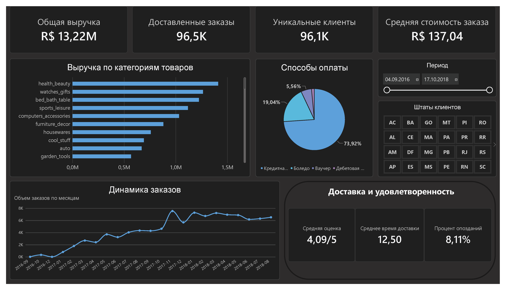

# Анализ данных маркетплейса Olist (PostgreSQL + Power BI)

Сквозной проект по анализу данных бразильского маркетплейса Olist. Включает написание SQL-скриптов, проектирование модели данных, аудит качества и создание интерактивного дашборда в Power BI.

## 🎯 Бизнес-задача
Проанализировать эффективность маркетплейса, выявить ключевые драйверы выручки, оценить качество логистики и понять поведение клиентов на основе исторических данных о заказах (сентябрь 2016 — октябрь 2018).

## 🛠 Стек технологий
* **База данных:** PostgreSQL (сложные запросы, CTE, очистка данных)
* **BI-инструмент:** Power BI (модель данных, DAX, дизайн дашборда)
* **Документация:** Markdown

## 📊 Архитектура данных
В основе дашборда лежит модель данных **«Созвездие» (Galaxy Schema)** с двумя таблицами фактов:
* `fact_orders` — агрегированные данные по заказам (статус, время доставки).
* `fact_order_items` — детализация по товарам в заказе (цена, количество).
Таблицы фактов связаны с общими измерениями (`dim_customer`, `dim_product`, `dim_date`). Это позволяет избежать дублирования данных и обеспечивает высокую скорость работы дашборда при фильтрации.

## 💡 Ключевые инсайты (Insights)
1. **Общие показатели:** Выручка составила **R$ 13.22 млн**, доставлено более **96.5 тыс.** заказов. Средний чек — **R$ 137.04**.
2. **Лидеры продаж:** Категории `health_beauty` (здоровье и красота) и `watches_gifts` (часы и подарки) приносят основную выручку.
3. **Логистика:** Средняя оценка клиентов — **4.09 из 5**. Среднее время доставки — **12.5 дней**. Доля опозданий составляет **8.11%**, что является существенным резервом для улучшения клиентского опыта.
4. **Оплата:** Около **74%** заказов оплачивается кредитными картами, на втором месте — боледо (19%).

## 🖼 Превью дашборда

*(Примечание: категории товаров оставлены на английском языке в соответствии с оригинальным справочником датасета Olist).*

## 🗂 Структура проекта
* `sql/` — SQL-скрипты для работы с базой данных:
  * `01_create_raw_tables.sql` — создание слоя сырых данных (Raw).
  * `02_data_quality_checks.sql` — аудит качества данных (поиск дублей, пропусков).
  * `03_analytics_views.sql` — создание очищенных VIEW и витрин фактов (Analytics).
* `power_bi/` — файл дашборда (`.pbix`), изображение и PDF-версия.
* `README.md` — описание проекта.

## 🚀 Как запустить проект
1. Скачайте исходный датасет с [Kaggle](https://www.kaggle.com/datasets/olistbr/brazilian-ecommerce).
2. Выполните скрипты из папки `sql/` в вашей базе PostgreSQL (по порядку от 01 до 03).
3. Откройте файл `.pbix` из папки `power_bi/` в Power BI Desktop и обновите подключение к вашей базе данных.

